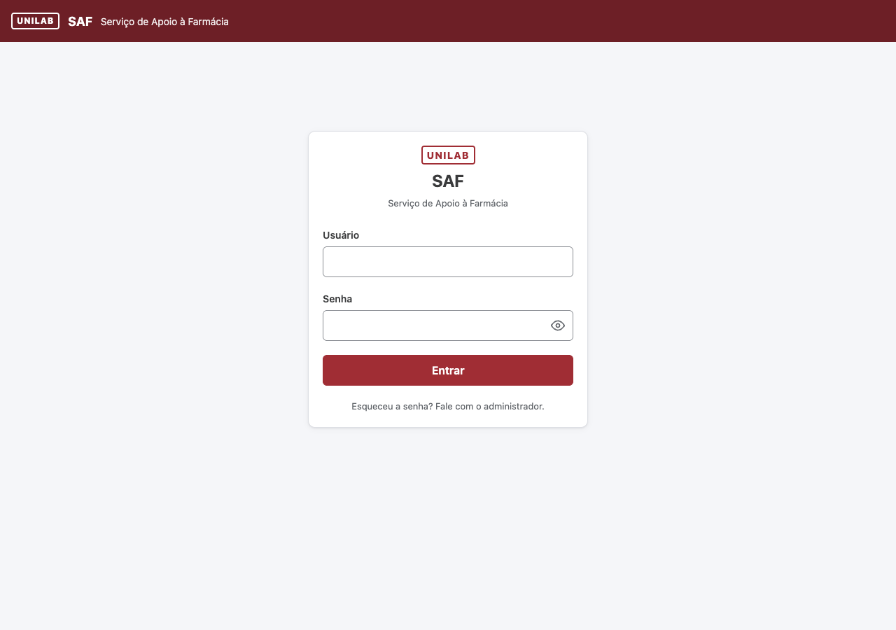
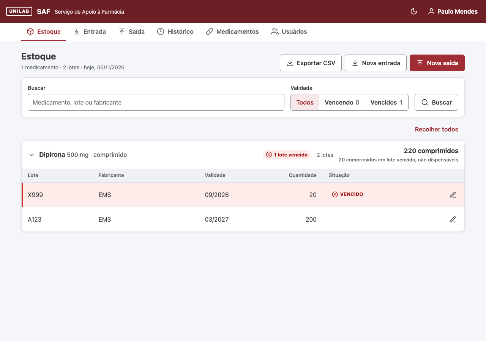
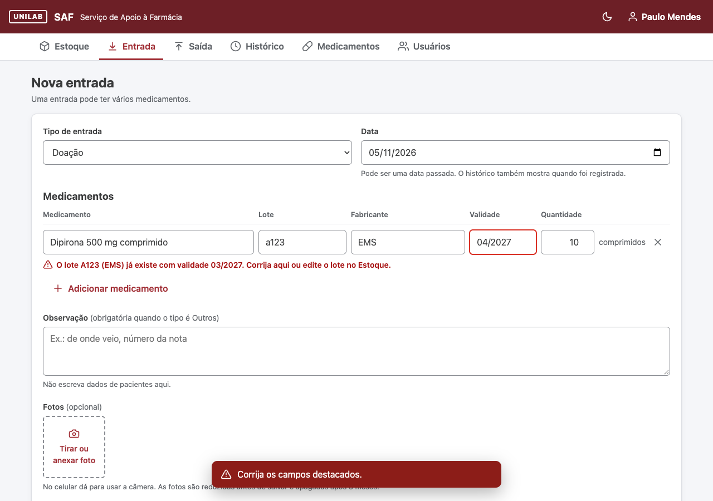
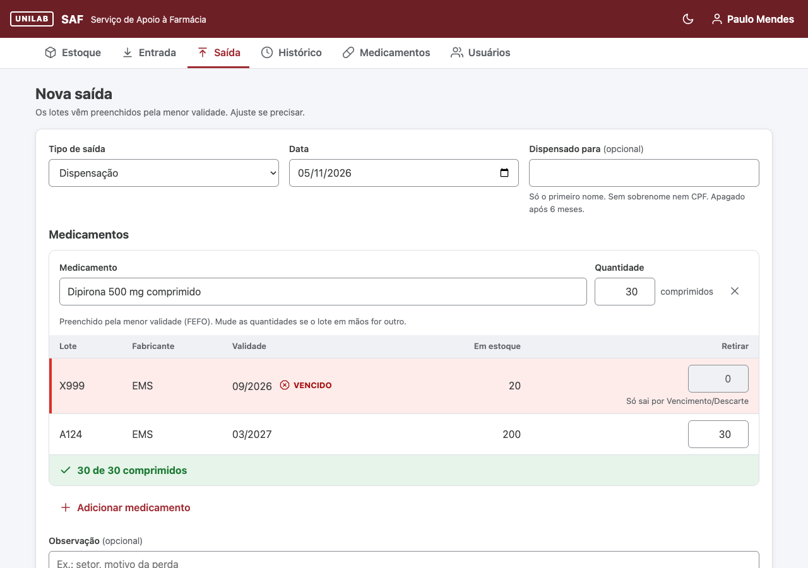
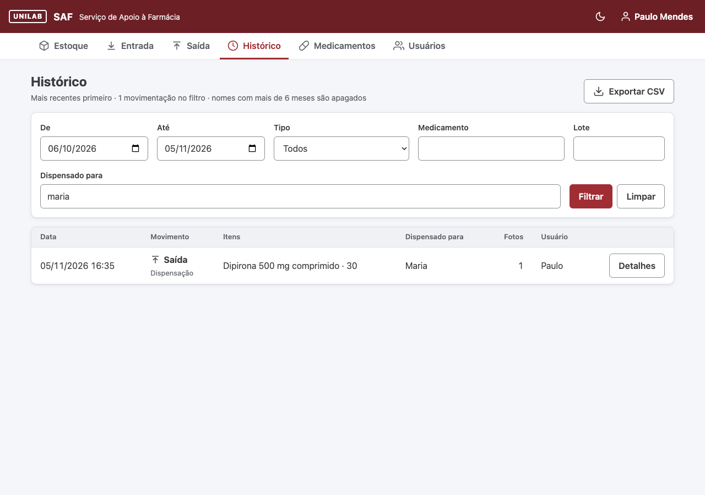
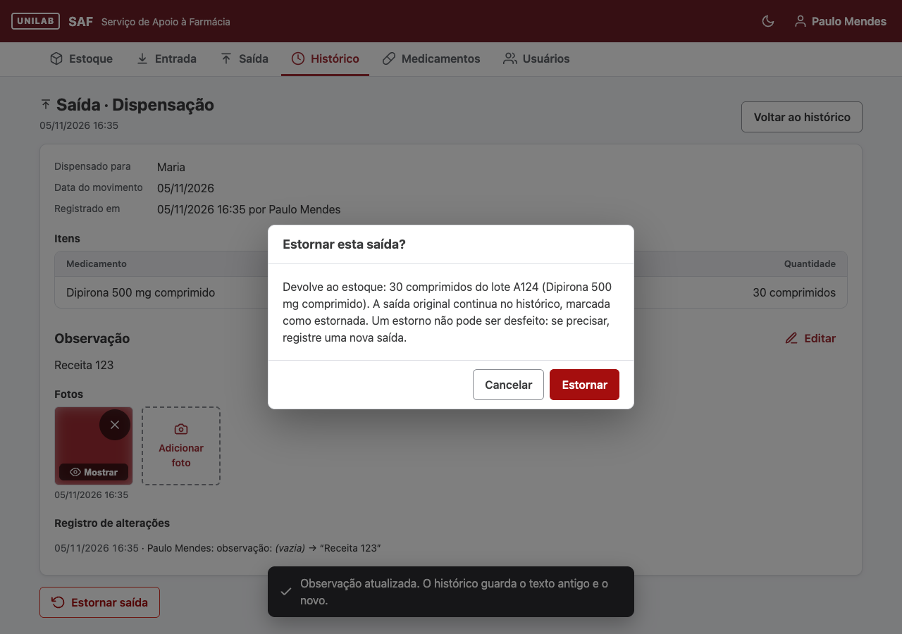
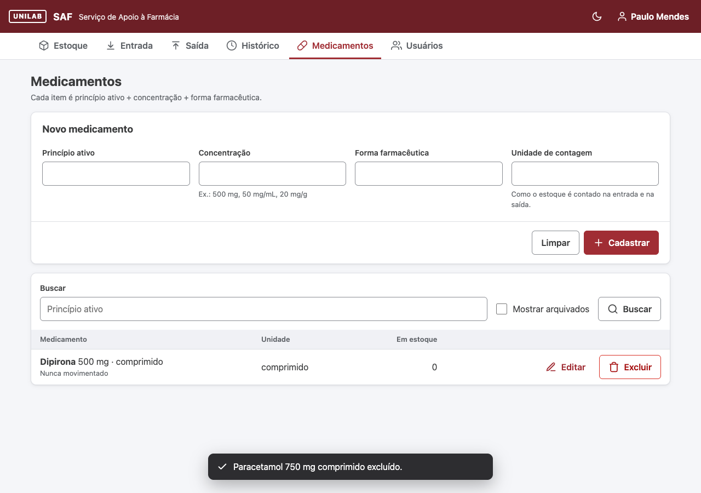
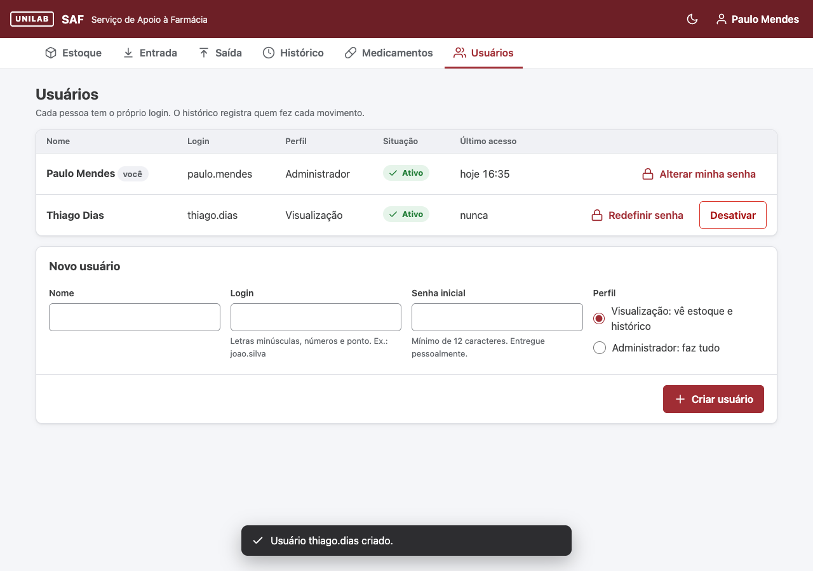
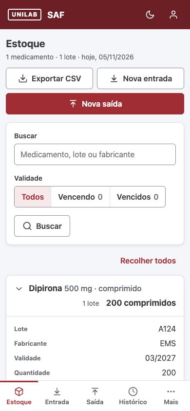

# SAF – Serviço de Apoio à Farmácia · Plan

Stock control for the UNILAB university pharmacy. One admin and one view-only user, pt-BR UI,
phone and desktop. Source requirements: `CRIAR UM SISTEMA DE CONTROLE DE ESTOQUE DE UMA FARMÁCIA UNIVERSITÁRIA.docx`.

**Internal control only.** SAF is not the legal record for controlled substances (SNGPC / Portaria 344).

The clickable prototype `docs/mockup/index.html` is the UI spec. The real app copies its CSS and markup;
screenshots of the real app are in `docs/screens/` (`SHOTS=docs/screens make smoke`). The prototype is frozen (2026-10-07): where it differs from this plan
(first-name rule, blurred photos, CSV without names, 6-month notice), the plan wins.

---

## 1. Decisions

### Product

| Topic | Decision |
|---|---|
| Users | Two roles. **Admin** does everything. **Viewer** sees Estoque and Histórico only. One login per person. A fresh install has `admin` / `primeiro-acesso`, which can only set up the real first administrator (name, login, password) and then stops existing; `admin` is a reserved login. `saf create-admin` adds an administrator from the CLI (recovery). |
| Login | Password only (no 2FA). 12–64 characters (bcrypt reads at most 72 bytes). 5 wrong tries lock the login for 15 min. |
| Medicine (catalog item) | Active ingredient + strength + dosage form + counting unit, all free text with suggestions. Duplicate = same ingredient + strength + form, ignoring case, accents and spaces. |
| Lot | Medicine + lot + manufacturer (same folding). Same lot again merges into it; a different expiry for the same lot blocks the save. |
| Expiry | `MM/AAAA`, valid until the last day of that month. Highlight when ≤ 90 days; expired lots are flagged. |
| Movements | Every entry and exit has 1..N lines. Stock is **always** the sum of lines; no stored balance. |
| Entry types | Doação, Permuta, Abastecimento, Devolução, Saldo inicial, Outros |
| Exit types | Dispensação, Perda, Extravio, Vencimento/Descarte, Permuta, Devolução ao fornecedor |
| FEFO | Exit lines are pre-filled from the lot with the closest expiry; editable per lot. Lines must add up to the requested quantity. Expired lots only leave by Vencimento/Descarte. |
| Dates | Movement date can be backdated, never in the future. "Registrado em" (save time + user) is always shown. |
| Corrections | Quantities: **estorno** only — a linked reversal of the whole movement, dated today, once per movement, blocked if the units already left. Text fields (observação, lot details, catalog fields): editable, logged old → new as "Ajuste" in Histórico. |
| Catalog removal | **Archive** (blocked while stock > 0). Real delete only if the medicine never moved. |
| Photos | Optional, several per movement, addable later, removable by the admin (logged). Shrunk in the browser to 1600 px JPEG before upload. |
| Histórico, Estoque | Filters + CSV export (`;`, UTF-8 with BOM, opens in Excel). Estoque is grouped by medicine, groups collapsed by default. |
| UI | pt-BR. Light + dark theme (device default, toggle saved in the browser). UNILAB palette: accent `#A02D34`, header `#6D1F26`, dark-theme accent `#DFA6A9`. Status text red `#A50E0E` + icon. |

Added while building the prototype and **pending the pharmacist's validation**: `MM/AAAA` expiry,
lot editing from Estoque, catalog edits logged as Ajuste, user deactivate/reactivate + password reset +
own password change, the login lock, photo picker without forced camera, status red `#A50E0E`
(the agreed `#D93025` is 4.4:1 on the page background, below the 4.5:1 minimum).

### Personal data (LGPD)

The app's job (stock, FEFO, history) needs no patient data. The only patient data kept:

| Data | Rule |
|---|---|
| "Dispensado para" | Optional, Dispensação only. **First name only**: one word, letters (accents allowed), ≤ 20 characters, checked in the browser and on the server. "Ana Paula" → type "Ana". |
| Photos | May show prescriptions with full name, CPF, diagnosis. |

Protection:

1. **Encrypted at rest.** First names and photo files are sealed with AES-256-GCM (Go standard library).
   The movement or photo id is bound as associated data, so a ciphertext copied to another row fails to open.
   Stock data is not encrypted (not personal data).
2. **Deleted after 6 months.** A job inside the app (at startup, then every 24 h) deletes **all photos**
   and **all first names** saved more than 6 months ago. Movements and quantities stay.
   SQLite `secure_delete` overwrites the deleted values.
3. **Backups expire.** The database replica (Litestream) keeps 30 days of history; the photo copy mirrors deletions.
   Everything is gone everywhere within about 7 months.
4. **Photos only through the app**, logged in, `Cache-Control: no-store`, blurred until clicked.
   Canvas re-encoding drops EXIF (phone GPS).
5. **UI hints:** Histórico says "Nomes e fotos com mais de 6 meses são apagados". The Observação field says
   "Não escreva dados do paciente aqui" — observações are not purged.

Encryption protects copies of the data (backup bucket, a copied database file). It does **not** protect
against a broken-into server or a stolen admin login; login security and HTTPS cover those.

**Key:** 32 random bytes, generated by `saf keygen`, stored outside the data folder and outside the backups
(e.g. `/etc/saf/key`), with a copy in a password manager. Lost key = the last ≤ 6 months of names and
photos are unreadable; stock is unaffected. No key rotation is built.

---

## 2. Architecture

```
 PC / phone browser ──HTTPS──▶ saf (one Go binary, one container)
                                 ├─ html/template pages + plain JS
                                 ├─ SQLite  DATA_DIR/saf.db      (names sealed)
                                 ├─ photos  DATA_DIR/photos/<id> (sealed files)
                                 └─ daily job: 6-month purge
                               litestream (same container) ──every change──▶ bucket: db/ (30 days)
 host timer (hourly) ── gcloud storage rsync ──────────────────▶ bucket: photos/ (mirror)
```

Why a web app and not a desktop app: two PCs would mean two databases (a backup is not a sync,
and a shared SQLite file on a network folder corrupts), and the phone must reach the app to send photos.

### Stack

- **Go 1.27** (currently 1.27.3; 1.25 left security support when 1.27 shipped; Go supports the two latest releases), standard library first: `net/http` (method routing), `html/template`, `embed`,
  `log/slog`, `encoding/csv`, `crypto/aes` + `crypto/cipher`, `image/jpeg` (upload check), `time/tzdata`.
- **Dependencies (only these):** `modernc.org/sqlite` (pure Go, no cgo), `golang.org/x/crypto` (bcrypt + `acme/autocert`),
  `github.com/stretchr/testify` (tests). Accent folding is hand-written for Portuguese letters instead of adding `x/text`.
- **Front end:** server-rendered pages, the prototype's CSS, plain JS for FEFO pre-fill, add/remove lines,
  `MM/AAAA` mask, photo shrink, confirm dialogs, theme toggle. No npm, no build step.
- **Security:** see §3.
- **SQLite:** WAL, `foreign_keys`, `busy_timeout=5000`, `synchronous=FULL`, `secure_delete`,
  writes in `BEGIN IMMEDIATE` transactions. Times stored in UTC; shown in `America/Fortaleza`.
- **Migrations:** numbered `.sql` files embedded in the binary, tracked with `PRAGMA user_version`,
  forward-only. When migrations are pending, the app snapshots the database first.

### Layout

```
cmd/saf/              main: serve | create-admin | keygen
internal/db/          open + pragmas, migrations, snapshot (VACUUM INTO)
internal/db/migrations/001_init.sql
internal/stock/       catalog, lots, movements, FEFO, estorno, stock queries, CSV rows, purge
internal/auth/        users, passwords, login lock, sessions
internal/form/        field-level validation messages (form.Errors)
internal/seal/        AES-256-GCM box + key file
internal/photos/      sealed photo files: save, open, delete
internal/web/         routes, handlers, middleware, templates/, static/
Dockerfile  Makefile  .github/workflows/check.yml
```

### Configuration

| Variable | Meaning |
|---|---|
| `SAF_DATA_DIR` | `saf.db`, `photos/`, `backups/`, `autocert/`. Default `./data`. |
| `SAF_KEY_FILE` | Path to the key. Required; the app refuses to start without a valid key. |
| `SAF_DOMAIN` | Set in production: HTTPS via Let's Encrypt (autocert) on 8443 + ACME/redirect on 8080. Empty = plain HTTP on 8080 for local work. |
| `SAF_REPLICA_URL` | Litestream's replica: `gs://<bucket>/db` in production, `file:///data/replica` locally. |

---

## 3. Security

Threat model: two staff users, health data, an internet-facing VM. The realistic attacks are bots scanning,
password guessing and a stolen login — not a targeted DDoS.

| Layer | Measure |
|---|---|
| **Network** (GCP firewall) | Port 443 only from Brazil: Cloud NGFW Standard geolocation rule (billed per GB evaluated, cents per month). Port 80 open worldwide but serves only the Let's Encrypt challenge and a redirect to HTTPS — Let's Encrypt validates from servers abroad. No public SSH: port 22 only from Google IAP (`35.235.240.0/20`, `gcloud compute ssh --tunnel-through-iap`). Everything else denied. |
| **Rate limit** (app) | Per client IP, in memory, hand-rolled (no dependency): 300 requests/min → `429` "Muitas requisições. Aguarde um minuto.". `POST /login`: 10/min per IP, on top of the per-login lock (5 wrong → 15 min). Both PCs and Wi-Fi phones likely share the university's public IP (NAT), so limits are sized for the whole pharmacy. Counters reset on restart. |
| **HTTP server** | Timeouts: read header 5 s, read 120 s (photo uploads on slow mobile data), write 60 s, idle 120 s. Headers ≤ 64 KB. Bodies capped with `http.MaxBytesReader`: forms 1 MB, photo uploads 8 MB and ≤ 10 photos → `413`. |
| **CORS** | **None.** The app never sends `Access-Control-*` headers, so browsers block every cross-origin read; `OPTIONS` gets `405`. No wildcard can exist because there is no CORS config. Pages, JS and photos are same-origin. |
| **Cross-site writes** | `http.CrossOriginProtection` rejects cross-origin `POST`s; session cookie `SameSite=Lax`. |
| **Headers** | A fixed set of security headers on every response, and checks on the headers browsers send — see [Headers](#headers). |
| **Sessions** | 32 random bytes in an `HttpOnly; Secure; SameSite=Lax` cookie; only the SHA-256 is stored; 12 h lifetime; deleted on logout, password reset and deactivation. |
| **Shared counter PC** | Logged-in pages, photos and CSV are never cached (`no-store`), so Back after logout shows nothing. Photos show blurred until "Mostrar foto" is clicked, so patients at the counter can't read a prescription on the screen. |
| **Supply chain** | `govulncheck` in `make check`; Dependabot (Go modules, base image, GitHub Actions); **Trivy image scan is mandatory and blocks the build** on fixable HIGH/CRITICAL findings, on every push and weekly on `main` (new CVEs appear without code changes). Base images pinned by digest; Litestream built from source with its libraries pinned in `third_party/litestream`, which Dependabot can't update (§6). |
| **Passwords** | bcrypt, 12–64 characters, per-login lock (§1). |
| **Data at rest** | First names and photos sealed; 6-month purge; backups expire (§1). |
| **Host** | Debian with `unattended-upgrades` (security patches). Container runs as non-root with a read-only root filesystem; only `DATA_DIR` writable; key mounted read-only. |
| **Logs** | Never log first names, photo contents, passwords or session tokens. Client IPs (personal data) are logged only on `429` and failed logins; Docker log rotation keeps ~30 days. |

### Headers

Sent on **every response** by one middleware (Go sends no `Server` header):

| Header | Value | Why |
|---|---|---|
| `Strict-Transport-Security` | `max-age=31536000; includeSubDomains` (HTTPS only) | Browser never falls back to plain HTTP. |
| `Content-Security-Policy` | `default-src 'self'; img-src 'self' blob:; connect-src 'self'; form-action 'self'; frame-ancestors 'none'; base-uri 'none'; object-src 'none'` | Only our own scripts and styles run (no inline); `blob:` for photo previews. |
| `X-Content-Type-Options` | `nosniff` | A file is never run as something else. |
| `X-Frame-Options` | `DENY` | Older browsers: no framing (clickjacking). |
| `Referrer-Policy` | `no-referrer` | URLs never leak to other sites. |
| `Cross-Origin-Opener-Policy` | `same-origin` | Other sites can't hold a handle to our window. |
| `Cross-Origin-Resource-Policy` | `same-origin` | Other sites can't embed our photos or files. |
| `Permissions-Policy` | `camera=(), microphone=(), geolocation=(), payment=(), usb=()` | No page can use these. The photo picker is a plain file input (the phone's own camera app), which this does not block. |
| `Cache-Control` | `no-store` on logged-in pages, photos, CSV; static files cached 1 day, URLs carry the build version | Shared counter PC. |
| `Clear-Site-Data` | `"cache"` on logout | Wipes cached pages. Not `"storage"`, which would also wipe the theme choice. |
| `Content-Type` | Always with `charset=utf-8`; CSV also `Content-Disposition: attachment` | |

Checked on **every request**:

| Request header | Rule |
|---|---|
| `Host` | Must be `SAF_DOMAIN`, else `421`. autocert only issues certificates for that name (`HostWhitelist`). Scanners hitting the bare IP get nothing. |
| `Sec-Fetch-Site`, `Sec-Fetch-Mode`, `Sec-Fetch-Dest` (sent by all current browsers) | `GET` from another site is allowed only as a top-level navigation (a link clicked elsewhere); any other cross-site load → `403`. Missing headers (old browser, curl) are allowed through. |
| `Origin` / `Sec-Fetch-Site` on `POST` | Same origin only (`http.CrossOriginProtection`). |
| `Content-Type` on `POST` | Only `application/x-www-form-urlencoded` or `multipart/form-data`, else `415`. |

What this does **not** stop:
- **A volumetric DDoS** fills the VM's network before Go sees a request. App rate limits stop password guessing
  and runaway scripts; the Brazil-only rule cuts most bot noise. If the app is attacked, the pharmacy falls back
  to paper and types the movements in later (backdating is allowed).
  **Cloudflare in front was considered and rejected (2026-10-07):** it would decrypt the traffic and see photos
  and names (another processor of health data), and it needs our own domain on Cloudflare DNS.
- **Geo-blocking is a filter, not a wall.** An attacker can use a Brazilian server. It also blocks legitimate
  users on a VPN, abroad, or possibly on iCloud Private Relay — test from the pharmacy's own phones in Phase 9.

---

## 4. Database

```sql
CREATE TABLE users (
  id            INTEGER PRIMARY KEY,
  name          TEXT NOT NULL,
  login         TEXT NOT NULL UNIQUE,
  password_hash TEXT NOT NULL,
  role          TEXT NOT NULL CHECK (role IN ('admin', 'viewer')),
  active        INTEGER NOT NULL DEFAULT 1,
  failed_logins INTEGER NOT NULL DEFAULT 0,
  locked_until  TEXT,
  last_login_at TEXT,
  created_at    TEXT NOT NULL
);

CREATE TABLE sessions (
  token_hash BLOB PRIMARY KEY,               -- SHA-256 of the cookie value
  user_id    INTEGER NOT NULL REFERENCES users(id),
  expires_at TEXT NOT NULL
);

CREATE TABLE medicines (
  id                INTEGER PRIMARY KEY,
  active_ingredient TEXT NOT NULL,
  strength          TEXT NOT NULL,           -- "500 mg", "50 mg/mL"
  dosage_form       TEXT NOT NULL,           -- "comprimido"
  unit              TEXT NOT NULL,           -- how stock is counted
  match_key         TEXT NOT NULL UNIQUE,    -- ingredient+strength+form, folded
  archived_at       TEXT,
  created_at        TEXT NOT NULL
);

CREATE TABLE batches (
  id           INTEGER PRIMARY KEY,
  medicine_id  INTEGER NOT NULL REFERENCES medicines(id),
  lot          TEXT NOT NULL,
  manufacturer TEXT NOT NULL,
  expiry_month TEXT NOT NULL,                -- 'YYYY-MM'
  match_key    TEXT NOT NULL,                -- lot+manufacturer, folded
  UNIQUE (medicine_id, match_key)
);

CREATE TABLE movements (
  id           INTEGER PRIMARY KEY,
  kind         TEXT NOT NULL CHECK (kind IN ('in', 'out', 'reversal')),
  type         TEXT NOT NULL,                -- 'Doação', 'Dispensação', 'Estorno de saída', ...
  occurred_on  TEXT NOT NULL,                -- movement date, local
  recorded_at  TEXT NOT NULL,                -- save time, UTC
  user_id      INTEGER NOT NULL REFERENCES users(id),
  note         TEXT NOT NULL DEFAULT '',
  patient_name BLOB,                         -- sealed first name; NULL if none or purged
  reverses_id  INTEGER UNIQUE REFERENCES movements(id)
);

CREATE TABLE movement_lines (
  id          INTEGER PRIMARY KEY,
  movement_id INTEGER NOT NULL REFERENCES movements(id),
  batch_id    INTEGER NOT NULL REFERENCES batches(id),
  quantity    INTEGER NOT NULL CHECK (quantity <> 0)   -- + in, - out
);
CREATE INDEX movement_lines_batch ON movement_lines(batch_id);

CREATE TABLE photos (
  id          INTEGER PRIMARY KEY,
  movement_id INTEGER NOT NULL REFERENCES movements(id),
  added_at    TEXT NOT NULL,
  added_by    INTEGER NOT NULL REFERENCES users(id),
  removed_at  TEXT,                          -- file deleted
  removed_by  INTEGER REFERENCES users(id)   -- NULL with removed_at = 6-month purge
);

CREATE TABLE changes (                       -- shown as "Ajuste" in Histórico
  id          INTEGER PRIMARY KEY,
  medicine_id INTEGER REFERENCES medicines(id), -- exactly one of these three is set
  batch_id    INTEGER REFERENCES batches(id),
  movement_id INTEGER REFERENCES movements(id),
  field       TEXT NOT NULL,                    -- 'Lote', 'Validade', 'Observação', ...
  old_value   TEXT NOT NULL,
  new_value   TEXT NOT NULL,
  user_id     INTEGER NOT NULL REFERENCES users(id),
  changed_at  TEXT NOT NULL,                    -- one save = one timestamp = one Ajuste entry
  CHECK ((medicine_id IS NOT NULL) + (batch_id IS NOT NULL) + (movement_id IS NOT NULL) = 1)
);
```

- Stock per lot = `SUM(quantity)` over `movement_lines`. Every write that removes units re-checks
  the touched lots inside the same transaction and rolls back if any would go below zero.
- Estorno = new `movements` row with `kind='reversal'`, `reverses_id` set, lines negated.
- Patient names never appear in `changes` ("Dispensado para" is not editable; fix with estorno + new saída).
  Photo files keep no original file name.

---

## 5. Screens and routes

| Screen | Route(s) | Prototype | Notes |
|---|---|---|---|
| Login | `GET/POST /login`, `POST /sair` |  | Lock message after 5 tries. |
| Estoque | `GET /estoque`, `GET /estoque.csv`, `POST /lotes/{id}` |  | Grouped by medicine, collapsed by default, search, filters (vencidos / vencendo), lot edit (admin). |
| Entrada | `GET/POST /entrada` |  | N lines; lot merge; expiry conflict blocks. |
| Saída | `GET/POST /saida` |  | One line per medicine, FEFO split per lot, sum check, expired blocked, first name for Dispensação. |
| Histórico | `GET /historico`, `GET /historico.csv` |  | Filters: period, type, medicine, lot, first name (decrypted in memory within the period). 10 per page. |
| Detalhe | `GET /movimentos/{id}`, `POST /movimentos/{id}/observacao`, `POST /movimentos/{id}/estorno`, `POST /movimentos/{id}/fotos`, `POST /fotos/{id}/remover`, `GET /fotos/{id}` |  | Lines, photos, change log, estorno. |
| Medicamentos | `GET/POST /medicamentos`, `POST /medicamentos/{id}`, `POST /medicamentos/{id}/arquivar`, `POST /medicamentos/{id}/excluir` |  | Duplicate check, archive/delete rules. |
| Usuários | `GET/POST /usuarios`, `POST /usuarios/{id}/senha`, `POST /usuarios/{id}/ativo`, `GET/POST /minha-senha` |  | Admin only, except own password. |
| Phone | same routes |  | Bottom tabs (≤ 5) + "Mais" menu. |

All writes are `POST` → redirect (no double submit on reload). The viewer gets 403 on every write route
and on the admin screens. Error messages are pt-BR, next to the field, with the prototype's wording.

---

## 6. Hosting, backup, cost

Phases 1–8 run on the laptop. Hosting is picked before Phase 9; only Phase 9 depends on it.

**Leaning:** GCP `e2-micro` in `us-east1`, pharmacy-owned account, Thiago maintains.
If UNILAB's encarregado requires the data in Brazil: Oracle Always Free (São Paulo) or a UNILAB server.

| Item | Cost / month |
|---|---|
| e2-micro VM, 10 GB **standard** disk (console default "balanced" is not free) | free tier |
| Public IPv4 (reserved, needed for the domain) | ≈ US$3.65 |
| Bucket (US region), ≤ 5 GB | free tier |
| Egress ≤ 1 GB (≈ 3,000 photo views) | free tier |
| Brazil-only firewall rule (Cloud NGFW Standard, US$0.0193 per GB evaluated) | cents |
| Domain: free DuckDNS subdomain (decided 2026-10-07) | free |

Sizing assumption: 20 photos/day × ~300 KB × 6 months ≈ 1.1 GB on disk and in the bucket.

**Domain:** a free DuckDNS subdomain with a neutral name (e.g. `<random>.duckdns.org`). `duckdns.org` is on the
Public Suffix List, so other DuckDNS sites can't set cookies for ours and Let's Encrypt limits count per subdomain.
The name is not secret: every certificate is published in Certificate Transparency logs, and bots read them.
If DuckDNS proves unreliable, moving to a paid domain (≈ R$40/year) takes one DNS change and one config value.

**Why SQLite on the VM and not a database server:**
- The risk of keeping the database on the app server is **durability** (one disk), not security. A separate database
  does not protect against a broken-into app server: the app holds the database password and reads everything anyway.
  A network database adds an exposed service and one more credential to protect.
- **Cloud SQL has no free tier.** The smallest instance (`db-f1-micro`, shared core, not covered by the SLA) is
  ≈ US$7–10/month plus storage. Free hosted Postgres elsewhere (Supabase, Neon) means another company holding the
  health data, and moving to Postgres adds a driver dependency and a database container to every test run.
- Durability comes from the backups below: Litestream copies every database change off the VM within seconds.

**Backup:**
- **Database — Litestream** (decided 2026-10-07): open-source single binary, runs in the same container as the
  parent process (`litestream replicate -exec "saf serve"`), streams every WAL change to `gs://…/db/`, keeps
  30 days of history. The Dockerfile builds it from its release source with our Go and every library
  upgraded (`third_party/litestream`): the official binary trailed on both and failed the Trivy gate
  (11 HIGH, 2026-11). Dependabot can't update that folder (no source next to it); when Trivy flags
  Litestream, run `make litestream-deps litestream-test check scan`. It manages WAL checkpoints, so the
  app never forces one. Restore = `litestream restore`; drilled locally against a file replica (`docs/DEPLOY.md` §12 for the real one).
- **Photos:** host systemd timer, hourly: `gcloud storage rsync` `photos/` → `gs://…/photos/` with
  `--delete-unmatched-destination-objects` (purge deletions propagate). Bucket soft delete off.
- **Before migrations:** the app writes a local `VACUUM INTO backups/pre-migration-<n>.db`.
- VM service account can write only to that bucket (Litestream and rsync use it, no key files).
- Worst case on total VM loss: seconds of database changes and ≤ 1 h of photos.
- **Restore drill** in Phase 9, then every 3 months: restore the database + photos to a laptop, run with the key, compare.

**Deploy:** multi-stage Dockerfile → static binary on `distroless/static` (has CA certs for Let's Encrypt).
Ship with `docker save | ssh vm docker load` (no registry). Run with `--restart=always`, ports 80→8080, 443→8443,
`DATA_DIR` and the key mounted from the host (key read-only at `/etc/saf/key`, owned by uid 65532 — the
container's non-root user — with mode 0400; without a readable key the app refuses to start).

---

## 7. Testing and checks

- `make check` = `gofmt -l` (must be empty) + `go vet` + `staticcheck` + `govulncheck` + `go test -race ./...`. GitHub Actions runs the same, then builds the image and runs Trivy (blocking). Dependabot opens update PRs weekly.
- Tests run on **real SQLite** in `t.TempDir()`; no mocks of our own code.
- `stock`: FEFO allocation, entry merge + expiry conflict, exit checks (expired, over-stock, sum),
  stock never below zero, estorno (once, blocked when units left, no estorno of estorno),
  archive/delete rules, change log, purge (older removed, younger kept, stock unchanged), CSV rows.
- `seal`: round trip; wrong key or wrong id fails.
- `auth`: password length rules, lock after 5 and unlock after 15 min, session expiry, deactivated user rejected.
- `web` (httptest, full stack): viewer 403 on writes, cross-origin POST rejected, CSP present,
  `/fotos/{id}` needs login, first-name rule ("Maria Silva" rejected), POST-redirect flow.
- Security: request 301 from one IP gets `429` while another IP still passes; 11th login `POST` per minute gets `429`;
  a request with `Origin: https://evil.example` gets no `Access-Control-*` header; `OPTIONS` gets `405`;
  oversized body gets `413`; every response carries the full header set; cross-site image load of `/fotos/{id}` gets `403` while a cross-site link click passes; wrong `Host` gets `421`; JSON `POST` gets `415`.
- `make smoke` (`test/browser/smoke.mjs`): builds the app, starts it on a fresh data dir, creates the admin through the CLI and
  clicks through it in headless Chrome over the DevTools protocol (Node 23+, no npm). Fails on any console error, CSP
  violations included. Grows with each phase. Not in CI.

---

## 8. Phases

Each phase ends with `make check` output, a screenshot next to the prototype, and your approval before the next one.

| # | Phase | Delivers |
|---|---|---|
| 1 | Skeleton | `go.mod`, `cmd/saf serve`, `internal/db` + `001_init.sql`, layout template with tabs + theme, CSS from the prototype, Makefile, Dockerfile, CI with govulncheck + Trivy (blocking) + Dependabot. `git init` + private GitHub repo (with your OK). |
| 2 | Auth + users + hardening | `create-admin`, login/logout, sessions, lock, roles, CSRF, response headers + request-header checks, rate limits, server timeouts, body caps, Usuários screen, own password. |
| 3 | Catálogo | Medicamentos: create, edit (logged), duplicate check, archive, delete. |
| 4 | Entrada + Estoque | Multi-line entry, lot merge/conflict, `MM/AAAA`, Saldo inicial; Estoque grouped + filters + expiry flags + lot edit + CSV. |
| 5 | Saída + encryption | `keygen`, `seal`, FEFO pre-fill + server checks, expired rule, sealed first name. |
| 6 | Histórico | List, filters, pagination, detail, observação edit, estorno, CSV. |
| 7 | Photos | Browser shrink, sealed files, view (blurred until clicked), add later, remove. |
| 8 | Retention | Daily 6-month purge; "Foto removida (prazo de 6 meses)"; pre-migration snapshot. |
| 9a | Deploy, local part *(done)* | HTTPS via autocert, Litestream in the image (built from source, libraries upgraded), `make release` (x86-64), photo-backup timer, `docs/DEPLOY.md`, local restore drill. |
| 9 | Deploy | VM with `unattended-upgrades`; firewall: 443 Brazil-only, 80 open for Let's Encrypt, SSH via IAP only; domain + autocert (check renewal works with the geo rule); container non-root + read-only, log rotation; Litestream + hourly photo sync + bucket lifecycle; restore drill; access test from the pharmacy's phones; first admin; initial stock (Saldo inicial) import. |

---

## 9. Open items

| # | Item | Owner | Default until answered |
|---|---|---|---|
| 1 | Is a US-hosted backup acceptable under LGPD? Legal basis (art. 11 II "f")? | UNILAB encarregado | GCP US |
| 2 | Should the CSV export include first names? (CSV files leave the system unencrypted and are never purged) | Thiago / pharmacist | **Omitted** |
| 3 | Should the viewer see first names and photos? | Thiago / pharmacist | Yes, as in the prototype |
| 4 | Who keeps a copy of the encryption key besides Thiago? | Pharmacy | Thiago's password manager |
| 5 | Sample of the current stock spreadsheet (for the Saldo inicial import) | Pharmacist | Manual entry |
| 6 | Permission to use the UNILAB logo | Pharmacist / UNILAB | Text-only header |
| 7 | Validate the prototype-only rules listed in §1 | Pharmacist | As in the prototype |

**Deferred (2026-10-07):** audit log of logins, photo views, CSV exports and user changes (LGPD art. 37 record of processing).

## 10. Risks

- **Single VM.** No high availability; total VM loss costs seconds of database changes (Litestream) and ≤ 1 h of photos. Acceptable for 2 users.
- **No real DDoS protection** (Cloudflare rejected, §3); the fallback is paper, typed in later.
- **Brazil-only rule** may block staff on a VPN, abroad, or on iCloud Private Relay.
- **Key custody.** Losing the key loses ≤ 6 months of names and photos; leaking it with a backup exposes them.
- **Free tier terms can change.** The app stays provider-agnostic (env config, `DATA_DIR`, Dockerfile).
- **Observação is free text** and is not purged; the field hint is the only control.
- **DuckDNS is a free service** with no uptime guarantee; an outage makes the app unreachable by name.
- **Login lock** can be triggered by someone guessing a login (15 min lockout); accepted for 2 users.
